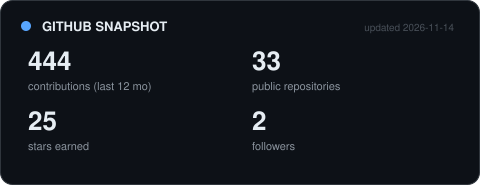
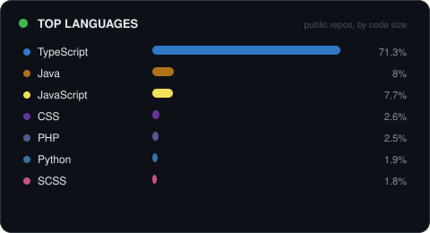

<h1 align="center">Hi, I'm Nguyên Kỷ 👋</h1>
<h3 align="center">Web Developer — building the Lappy suite of apps & tools</h3>

🎓 Information Technology, Van Lang University · 📍 Vietnam · 🏢 Lappy

---

### About me

- 🌐 Full-stack web development with **React**, **Next.js**, **Node.js** and **TypeScript**
- 🧰 Developer tooling & automation — CLIs, refactoring tools, test automation
- 📱 Cross-platform work: **Android/Kotlin**, **Flutter/Dart**
- ⭐ Top open-source release: [Windsurf Trial Reset](https://github.com/zliveze/Winsurf-pro-trial-reset-tool) (21★)

### Selected work

| Project | Stack | Description |
|---|---|---|
| [zalo-sound-guard](https://github.com/zliveze/zalo-sound-guard) | Kotlin | Android service that fixes Zalo's per-conversation notification sound reset — without root |
| [Monolith-splitter](https://github.com/zliveze/Monolith-splitter) | JavaScript | Zero-dependency CLI that decomposes 1,000–15,000-line monoliths into clean modules |
| [lappy_shoes_store](https://github.com/zliveze/lappy_shoes_store) | Next.js · TS · Tailwind | E-commerce storefront for Lappy Shoes |
| [LappyTube](https://github.com/zliveze/LappyTube) | Python | Desktop app for downloading YouTube videos |
| [Winsurf-pro-trial-reset-tool](https://github.com/zliveze/Winsurf-pro-trial-reset-tool) | PowerShell | Most-starred release (21★) |

<b>More projects</b>

- [Lappy_Hacking](https://github.com/zliveze/Lappy_Hacking) — cross-platform ID management for AI IDEs (Cursor, Windsurf) · Python · 2★
- [Qoder-Trial-Reset](https://github.com/zliveze/Qoder-Trial-Reset) · Python · 2★
- [LAPAutoSMS](https://github.com/zliveze/LAPAutoSMS) — Android SMS automation · Kotlin
- [Fluffy](https://github.com/zliveze/Fluffy) — Flutter app · Dart
- [Domain-Manager](https://github.com/zliveze/Domain-Manager), [lappy-qr](https://github.com/zliveze/lappy-qr), [Count-Gender](https://github.com/zliveze/Count-Gender) · TypeScript
- [AI-Library](https://github.com/zliveze/AI-Library), [Lappy-Photographer](https://github.com/zliveze/Lappy-Photographer) · JavaScript
- [Automation-Testing-VanLangUniversity](https://github.com/zliveze/Automation-Testing-VanLangUniversity) — test automation · Java

### Toolbox

**Web**

**Tooling & automation**

**Mobile**

### GitHub

Charts generated from live GitHub data by <code>tools/update-stats.ps1</code> — public repos only.

